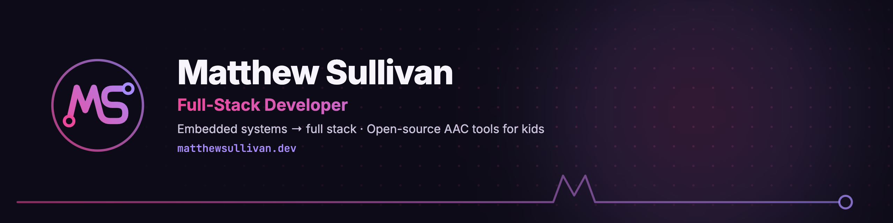

# Matthew Sullivan — Portfolio

Personal portfolio and live full-stack demo.
**[matthewsullivan.dev](https://matthewsullivan.dev)**

---

## Stack

| Layer | Technology |
|---|---|
| Frontend | React 19, Vite 7, TypeScript 5, React Router 7 |
| Styling | Tailwind CSS v4, CSS custom properties, self-hosted Inter + JetBrains Mono |
| Animations | Framer Motion 12 |
| Backend | Hono 4 on Cloudflare Workers |
| Database | Cloudflare D1 (SQLite edge DB) + Prisma |
| File Storage | Cloudflare R2 (resume PDF) |
| WebAssembly | C compiled with clang (`wasm32`) + wasm-ld for the LED demo; satori + resvg on the Worker for images |
| Email | Resend |
| Auth | Single-password bcrypt + 24h HS256 JWT |
| Monorepo | pnpm workspaces |
| Hosting | Cloudflare Pages (web) + Cloudflare Workers (API at `api.matthewsullivan.dev`), deployed by GitHub Actions (on push, daily, and on demand) |

---

## Repository Structure

```
portfolio/
├── brand/                 # Logo, favicons, banners, link-preview cards, templates (see brand/README.md)
├── apps/
│   ├── web/               # React SPA (Cloudflare Pages)
│   │   ├── scripts/prerender.mjs  # Build-time render of the homepage (runs after vite build)
│   │   ├── scripts/activity.mjs   # GitHub contribution calendar + latest commits → public/activity.json (CI only)
│   │   ├── wasm/                  # leds.c (LED "firmware") + build.sh → public/leds.wasm
│   │   ├── public/                # Favicons, fonts, og-image.png, portrait/, leds.wasm, _headers, _redirects, /brand page
│   │   └── src/
│   │       ├── entry-server.tsx   # Server entry used by the prerender
│   │       ├── components/
│   │       │   ├── layout/        # Header, Footer
│   │       │   ├── sections/      # Hero, LiveStatus, Skills, Experience, Projects, Playground, Education, AboutMe, Contact
│   │       │   ├── playground/    # CardMaker, LedPanel, ActivityGrid
│   │       │   ├── Portrait.tsx   # Hero headshot in the brand ring (Goose on click)
│   │       │   ├── EasterEggs.tsx # All global easter egg listeners
│   │       │   ├── RingRunner.tsx # Hidden LOTR canvas game
│   │       │   ├── BrandMark.tsx  # Inline MS logo (header, footer)
│   │       │   ├── CommandPalette.tsx
│   │       │   ├── BackToTop.tsx
│   │       │   ├── GyroPermission.tsx
│   │       │   └── ScrollProgress.tsx
│   │       ├── context/           # ThemeContext, AuthContext
│   │       ├── hooks/             # useTilt (3-D card effect, gyroscope on mobile)
│   │       ├── lib/               # api.ts, prerendered.ts, smoothScroll.ts, gameAudio.ts, token.ts
│   │       ├── pages/             # Home, admin/Dashboard, admin/Login, admin/ProjectForm
│   │       └── router/
│   └── api/               # Hono REST API (Cloudflare Workers)
│       └── src/
│           ├── middleware/        # CORS, adminAuth (JWT guard)
│           └── routes/            # auth, projects, contact, resume, og, leaderboard, analytics, status
│       └── migrations/            # D1 schema migrations (0001–0005)
└── packages/
    └── shared/            # Zod schemas + TypeScript types (consumed by both apps)
```

---

## Features

### Frontend
- **Liquid glass UI** — all cards use layered `backdrop-filter` glass effects, in the pink→violet brand palette (see `brand/`)
- **Pre-rendered homepage** — `scripts/prerender.mjs` renders the page to static HTML at build time with the projects inlined, so crawlers and link previews get real content and the project cards don't flash a skeleton
- **"Now" card** — what I'm working on, next to the hero (`NOW` in `Hero.tsx`)
- **Hero portrait** — headshot inside the MS logo's ring; on load a signal trace with the logo's "M" draws around it, the ring always orbits and glows, hover lifts it, it tilts toward the cursor, and clicking swaps in Goose (`Portrait.tsx`)
- **"This site, right now" card** — live numbers above Skills: the Cloudflare edge that answered, the browser's round trip (with Ping again), a timed D1 query, Worker time, the deployed commits, and the latest GitHub Actions runs (`LiveStatus.tsx` + `GET /api/status`)
- **Playground** — three live demos after Projects:
  - *Link-preview card maker*: type a title and the Worker renders a 1200×630 card with satori + resvg, showing the round trip and edge-cache hit/miss
  - *Firmware in your browser*: a 32×8 LED matrix driven by C written like microcontroller code (no libc, no malloc, fixed timestep), compiled to a 2.7 KB WebAssembly module; four patterns, click LEDs to draw Game of Life cells
  - *Shipping activity*: the GitHub contribution calendar and latest commits, rebuilt daily by the deploy workflow
- **Try it live** — project cards can link straight to a project's interactive demo (`demoUrl` / `demoLabel`, editable in the admin)
- **Reading tools** — from ClearPath: a reading ruler, a dyslexia-friendly font (self-hosted OpenDyslexic, content only), and read-aloud of the section in view with word highlighting via the CSS Custom Highlight API; settings persist (header book icon, mobile menu, ⌘K; `components/ReadingTools.tsx`, `lib/readAloud.ts`)
- **Goose** — hover or tap the Cat Dad card for photos of my cat
- **Dark / light mode** — CSS custom-property token system; preference stored in `localStorage`
- **3-D tilt cards** — mouse-tracking perspective transform on desktop; gyroscope tilt on mobile (iOS permission flow included)
- **Smooth custom scroll** — eased `requestAnimationFrame` scroll for all nav links and the Back to Top button (easeInOutCubic, 500–900 ms adaptive duration)
- **Command palette** — ⌘K / Ctrl+K opens a full-screen searchable palette with nav links, resume download, and social links
- **Scroll progress bar** — accent-coloured indicator at the top of the viewport
- **Typewriter hero** — cycling role titles with typing / pausing / deleting state machine
- **Animated dot-grid background** — subtle drifting dot pattern in the hero
- **Parallax hero** — content translates upward on scroll using `useTransform`
- **Responsive hamburger menu** — animated with height + opacity transition; haptic feedback on supported devices
- **Back to Top button** — appears when you scroll back up (or reach the bottom) after 600 px; haptic on tap
- **prefers-reduced-motion** — all CSS animations and Framer Motion respect the system preference
- **Safe area insets** — fixed elements use `env(safe-area-inset-bottom/top)` for notched phones
- **iOS input zoom fix** — inputs use `text-base md:text-sm` to prevent iOS auto-zoom

### Backend API
- JWT-protected admin CRUD for projects and contact submissions
- Contact form with Zod validation (length-capped), Resend email delivery, and D1 persistence
- Per-IP rate limits on every public write or render route (Workers Rate Limiting bindings in `wrangler.toml`)
- Live status endpoint and playground card renderer (see API Routes)
- Resume served from Cloudflare R2; updatable via admin panel without redeployment
- Site analytics for the admin dashboard, read from Cloudflare Web Analytics through the GraphQL API
- Shared Zod schemas between frontend and API (`packages/shared`)

### Admin Panel (`/admin`)
- Single-password login → 24-hour JWT stored in `localStorage`
- Manage projects (create, edit, delete), including the optional "Try it live" demo link
- View and mark contact submissions as read
- Upload a new resume PDF directly to R2
- See page views and top pages from Cloudflare Web Analytics

---

## Easter Eggs

There are more hidden easter eggs than the ones below, all LOTR themed. None are mentioned anywhere on the site, and they keep their gold even though the rest of the site moved to pink.

### 🧙 A — The One Ring (Konami Code)
**Trigger:** Type the Konami Code on your keyboard: `↑ ↑ ↓ ↓ ← → ← → B A`
**Effect:** A full-screen overlay appears displaying the One Ring and the full Ring inscription in the Dark Speech of Mordor. Click anywhere to dismiss.

### 🧙 B — Gandalf Quote (type "shire")
**Trigger:** Type the word `shire` anywhere on the page (no input focused needed).
**Effect:** A toast notification pops up from the bottom-right corner with a randomly chosen Gandalf quote. Disappears after 5 seconds.

### 🐍 H — "My Precious" (Python tag)
**Trigger:** Click the `Python` skill tag in the Skills section.
**Effect:** A small tooltip appears above the tag showing the One Ring image and the text *"My Precious…"* in italic serif. Disappears after 3 seconds.

### 🕹️ G — The Road to Mordor (hidden mini-game)
**Trigger:** Go to the **About → Beyond the Code** section. Find the **Gamer** card with the 🕹️ icon. **Hold the card for 1.5 seconds.** A gold progress ring fills around the card while you hold; release early to cancel.
**Effect:** Opens a full Lord of the Rings–themed infinite runner:
- Play as 🧙 Gandalf dodging 🗡️ swords on the ground
- 🦅 Nazgûl fell beasts appear as aerial obstacles after score 100
- All sounds are synthesized with the Web Audio API (no audio files): jump blip, death sequence, milestone fanfare (C5→E5→G5→C6), Nazgûl shriek with LFO vibrato
- Score milestones at 100, 500, and 1000 play a fanfare
- Speed ramps up gradually (linear, Google-dino style) from 5.5 → 13 px/frame over ~4 minutes
- **Persistent shared leaderboard** — top 10 scores stored in D1; on death, players with a qualifying score are prompted for a 3-character name before seeing the Hall of Fame. Each run gets a signed start ticket from the API, and scores higher than the run's elapsed time allows are rejected
- **🏆 Hall of Fame button** in the game header — view the board at any time before playing
- **Desktop:** Space / ↑ arrow to jump, ESC to close, click the canvas to jump
- **Mobile:** Square `aspect-square` canvas wrapper — the wide game canvas is letterboxed with the sky colour, giving a much larger play area. Tap anywhere to jump; only the ✕ and 🏆 buttons don't trigger a jump
- **Idle prompt:** "Run, you fools!" / **Death screen:** "YOU SHALL NOT PASS! 🔥"

### 👁️ F — The Eye of Sauron (idle detection)
**Trigger:** Leave the page idle (no mouse movement, scrolling, clicks, or key presses) for **1 full minute**.
**Effect:** The Eye of Sauron appears as a glowing card in the bottom-left corner with the message *"I see you…"* pulsing in red. Click it to dismiss. Dismissing it plays a synthesized fire whoosh sound and restarts the idle timer.

### ⌘K — Command Palette (bonus power-user feature)
**Trigger:** Press `⌘K` (Mac) or `Ctrl+K` (Windows/Linux), or click the `⌘K` hint button in the desktop header.
**Effect:** Opens a searchable command palette with quick nav links, resume download, and social links. Not strictly a secret, but not labeled as a feature either.

---

## Local Development

**Prerequisites:** Node.js 20+, pnpm 9+, Cloudflare account.

```bash
# Install dependencies
pnpm install

# Copy and fill in local secrets: .env.example has the blocks for
# apps/api/.dev.vars and apps/web/.env.local
cp .env.example apps/api/.dev.vars   # then keep only the .dev.vars block

# Start both apps in parallel
pnpm dev
```

- Frontend: `http://localhost:5173`
- API: `http://localhost:8787`

---

## API Routes

| Method | Path | Auth | Purpose |
|---|---|---|---|
| GET | `/api/health` | — | Uptime check |
| POST | `/api/auth/login` | — | Returns 24 h JWT |
| GET | `/api/projects` | — | Published projects |
| GET | `/api/projects/all` | JWT | All projects, including drafts |
| GET | `/api/projects/:id` | JWT | Single project (for the edit form) |
| POST | `/api/projects` | JWT | Create project |
| PUT | `/api/projects/:id` | JWT | Update project |
| DELETE | `/api/projects/:id` | JWT | Delete project |
| POST | `/api/contact` | — | Submit contact form (3/min per IP) |
| GET | `/api/contact` | JWT | List submissions |
| PUT | `/api/contact/:id/read` | JWT | Mark as read |
| GET | `/api/resume` | — | Stream resume PDF from R2 |
| PUT | `/api/resume` | JWT | Replace resume PDF in R2 |
| GET | `/api/og` | — | Dynamic 1200×630 card (PNG), a demo of satori + resvg on Workers |
| GET | `/api/og/card` | — | Playground card from `?title=&subtitle=&theme=`; edge-cached per input, `X-Cache: HIT/MISS`, new renders 10/min per IP |
| GET | `/api/status` | — | Live numbers for the homepage card: colo, D1 timing, Worker time, deployed commit (30/min per IP) |
| GET | `/api/leaderboard` | — | Top 10 Ring Runner scores |
| GET | `/api/leaderboard/start` | — | Signed start-of-run ticket |
| POST | `/api/leaderboard` | — | Submit a score with its ticket (5/min per IP; scores the clock can't explain are rejected) |
| GET | `/api/analytics` | JWT | Page views for the admin dashboard (`?days=1–90`) |

---

## Deployment

Pushing to `main` deploys automatically with GitHub Actions: `.github/workflows/deploy-web.yml` builds and pre-renders the site and deploys it to Cloudflare Pages, and `deploy-api.yml` deploys the Worker. Each only runs when its app (or `packages/`) changes.

- **Web:** before building, `scripts/activity.mjs` fetches the GitHub contribution calendar with the workflow's own `GITHUB_TOKEN` and writes `public/activity.json` (gitignored; the previous file is kept if GitHub is down). The workflow also runs daily and from the Actions tab (`workflow_dispatch`) to keep that grid current. `VITE_BUILD_SHA` is passed in for the live card.
- **API:** deployed with `--var GIT_SHA` and `--var DEPLOYED_AT` so `/api/status` can report the running commit.
- **Database migrations are applied by hand**, before pushing code that reads new columns: `pnpm --filter api db:migrate:remote`. The homepage is pre-rendered from the live API, so if a site build lands before the API deploy, re-run **Deploy Web** from the Actions tab.
- **WebAssembly:** `public/leds.wasm` is committed. Rebuild it after editing `wasm/leds.c` with `apps/web/wasm/build.sh` (needs `brew install llvm lld`).

The site reads the API address from `apps/web/.env.production` (`VITE_API_URL=https://api.matthewsullivan.dev`); it's committed because it's a public URL baked into the bundle.

### First-time API setup

```bash
# Create the D1 database and R2 bucket
wrangler d1 create portfolio-db
wrangler r2 bucket create portfolio-assets

# Apply DB migrations
wrangler d1 migrations apply portfolio-db --remote

# Secrets
wrangler secret put JWT_SECRET
wrangler secret put ADMIN_PASSWORD_HASH     # bcrypt hash of your admin password
wrangler secret put RESEND_API_KEY
wrangler secret put CONTACT_EMAIL
wrangler secret put CLOUDFLARE_API_TOKEN    # Analytics read, for /api/analytics
wrangler secret put CLOUDFLARE_ACCOUNT_ID
```

The custom domain is set in `apps/api/wrangler.toml` (`routes`, `custom_domain = true`); the `workers.dev` URL is off.

To upload a resume without the admin panel:
```bash
wrangler r2 object put portfolio-assets/resume.pdf --file ./resume.pdf --remote
```

---

## Auth

No external auth provider. A single bcrypt-hashed password is stored as a Worker secret (`ADMIN_PASSWORD_HASH`). `POST /api/auth/login` verifies it and returns a 24-hour HS256 JWT. The admin panel stores the token in `localStorage` and validates expiry on every navigation.

Generate the initial hash:
```bash
node -e "const b = require('bcryptjs'); b.hash('your-password', 12).then(console.log)"
```

---

## Key Technical Notes

### CSS Token System (Dark / Light Mode)
All colors are CSS custom properties on `:root` (dark defaults), overridden on `html.light`. Mapped to Tailwind tokens via `@theme inline`. Toggled by `ThemeContext` which adds/removes the `.light` class on `<html>` and persists to `localStorage`.

### 3-D Tilt Effect (`src/hooks/useTilt.ts`)
- **Desktop:** `mousemove` computes cursor position relative to card center → `perspective(700px) rotateX rotateY`
- **Mobile:** A module-level singleton registers all tilt cards in a `Set<HTMLElement>`. Uses a **delta-based** (velocity) model rather than absolute orientation: each `deviceorientation` event computes the *change* in gamma/beta since the last reading and accumulates that into `targetX/Y`, clamped to ±1. A `requestAnimationFrame` loop decays the target toward zero each frame (cards spring back to flat when still) and lerps `currentX/Y` toward the target (smooths rendering). This means any static hold angle — phone straight up, tilted, lying in bed — reads as neutral; only active movement produces tilt. iOS requires `DeviceOrientationEvent.requestPermission()` from a user gesture; `GyroPermission.tsx` handles the prompt.

### Smooth Scroll (`src/lib/smoothScroll.ts`)
Custom `requestAnimationFrame` loop with `easeInOutCubic`. Duration is adaptive: `clamp(distance × 0.6ms, 500ms, 900ms)`. Used by all nav links, the Back to Top button, and hero CTAs instead of native `scroll-behavior: smooth`.

### Game Audio (`src/lib/gameAudio.ts`)
All sounds are synthesized at runtime using the Web Audio API — no audio files. `AudioContext` is a lazy singleton (browsers require a user gesture before audio can start). See file comments for synthesis details on each sound.

### Link previews
The site's `og:image` is the static brand card at `/og-image.png?v=N` (1200×630, from `brand/social/`). Bump `v` whenever the image changes: LinkedIn caches preview images by URL.

### Dynamic OG Image (`apps/api/src/routes/og.ts`)
`GET /api/og` renders a 1200×630 PNG at request time. It's kept as a demo of running satori and resvg on Workers; the site itself uses the static card above. The pipeline:
1. **satori** (`satori/standalone`) — converts a JSX-like element tree to an SVG string, converting text to paths using Inter font data fetched from jsDelivr at cold-start.
2. **resvg** (`@cf-wasm/resvg/workerd`) — renders the SVG to a PNG via a Rust-powered WebAssembly renderer.

Both WASM binaries (yoga layout engine + resvg) are bundled at build time by Wrangler's `[[rules]] type = "CompiledWasm"` entry. Cloudflare Workers blocks runtime WASM compilation from raw bytes (`WebAssembly.compile` / `WebAssembly.instantiate(bytes, …)`), but allows instantiation of pre-compiled `WebAssembly.Module` objects. The yoga WASM binary (`src/yoga.wasm`) is extracted from `yoga-layout`'s base64-embedded bundle so its Emscripten glue code matches exactly.

On any error the route issues a 302 to the static `/og-image.png` fallback on Cloudflare Pages, so social cards never break.

### Live status card (`LiveStatus.tsx`, `routes/status.ts`)
Every number is measured on the request: `request.cf.colo` for the data centre, a timed `SELECT` against D1 (Workers clocks only advance across I/O, which is what's being timed), and the deployed commit from `GIT_SHA`. The browser measures the round trip itself. GitHub Actions runs are fetched **from the browser**, not the Worker: unauthenticated GitHub API calls are limited per IP, and Cloudflare's shared egress IPs are always over that limit.

### LED firmware (`apps/web/wasm/leds.c`)
Freestanding C (`-nostdlib -ffreestanding`, one 64 KB memory page, 8 KB stack): a framebuffer of one brightness byte per LED, a fixed 16 ms timestep, xorshift randomness, and a 5×7 font table holding only the glyphs it needs. The page calls `tick(elapsedMs)` every animation frame and draws the framebuffer straight out of WebAssembly memory. It pauses off screen and starts paused with reduced motion.

### Content Security Policy
`public/_headers` sets a strict CSP. Additions for the live demos: `script-src 'wasm-unsafe-eval'` (required to instantiate WebAssembly) and `connect-src https://api.github.com` (CI runs on the live card). Its `upgrade-insecure-requests` directive breaks local testing over `http://localhost` with `wrangler pages dev`; use `pnpm dev` (Vite ignores `_headers`).

### Resume Storage
The resume PDF lives in a Cloudflare R2 bucket (`portfolio-assets`). `GET /api/resume` streams it publicly with a 7-day `Cache-Control`; `PUT /api/resume` is JWT-protected and accepts a multipart form upload. Updating the resume requires no redeployment.

### Brand
The MS signal mark, colours, type, and every rendered asset live in `brand/` (with HTML templates to re-render them). The public guide is at [matthewsullivan.dev/brand](https://matthewsullivan.dev/brand/).

### Performance
- **Code splitting** — Admin routes (`Login`, `Dashboard`, `ProjectForm`, `AdminLayout`) are `React.lazy()` + `Suspense`. Non-admin visitors never download that code. Vite `manualChunks` splits React/Router and Framer Motion into separately cached vendor chunks; the main app chunk went from 472 KB → 132 KB (gzip: 146 KB → 37 KB).
- **HTTP caching** — `GET /api/projects`: 5 min `public` cache. `GET /api/leaderboard`: 60 s `public` cache. `GET /api/resume`: 7-day `public` cache. `GET /api/og/card`: cached at the edge per input for a day.
- **Image lazy loading** — off-screen images (`loading="lazy" decoding="async"`) defer fetching until near the viewport.
- **React rendering** — `ProjectCard` and `SkillCard` are wrapped in `memo()` to skip re-renders from unrelated state changes (theme toggle, nav intersection, etc.).
